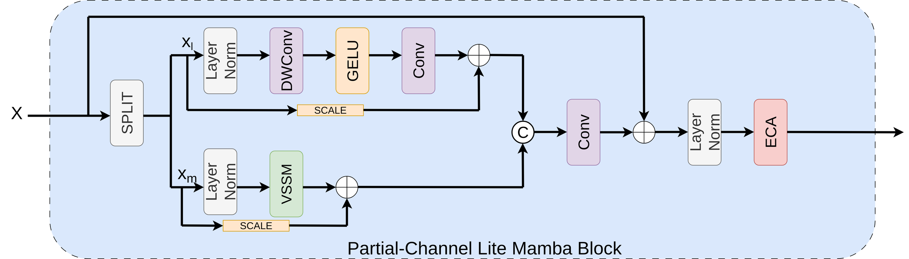
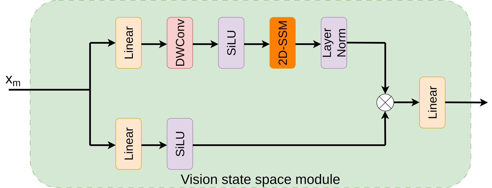
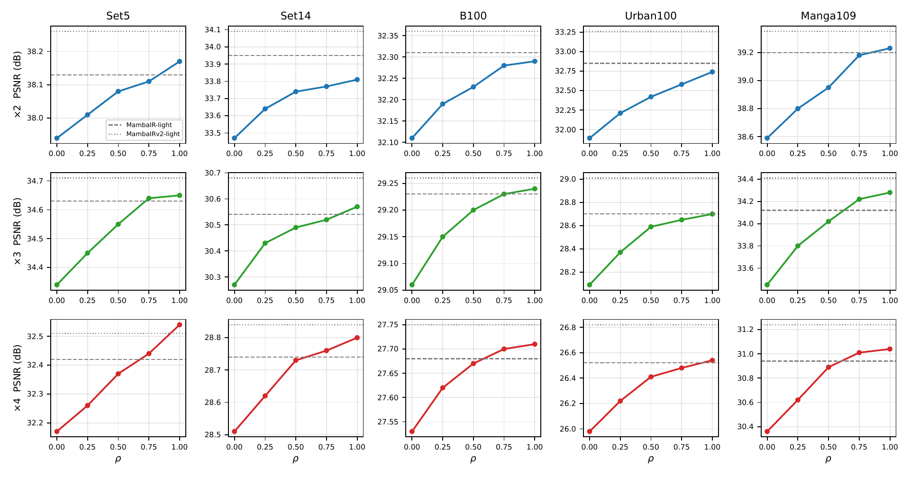
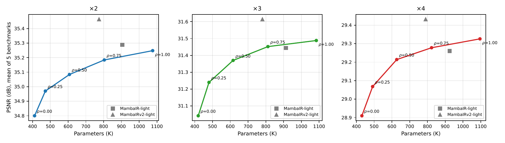
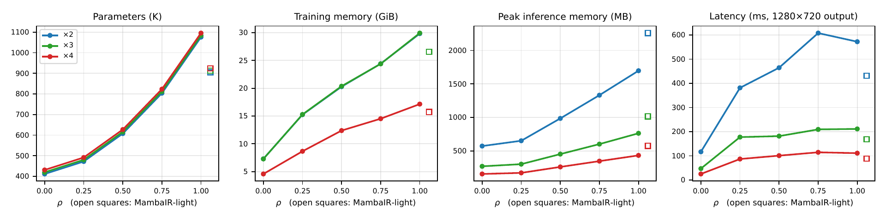
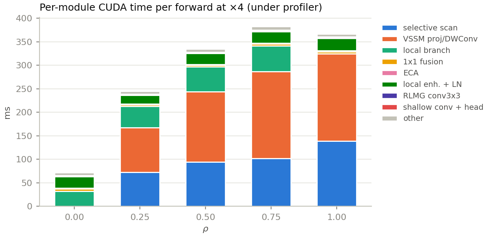
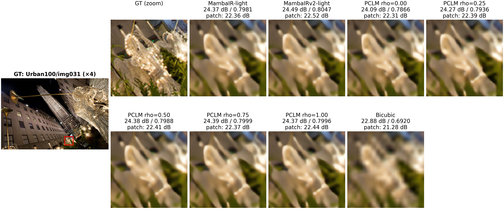
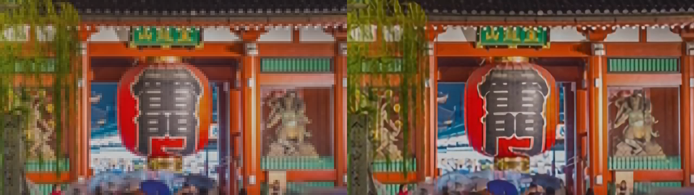

# 🐍 The Price of Global Context in Lightweight Mamba Image Super-Resolution

<p align="center">
  
</p>

📄 Official code of the paper **"The Price of Global Context in Lightweight Mamba Image Super-Resolution"**, accepted at the **6th IEEE International Workshop on Machine Learning and
Computing for Visual Semantic Analysis (MLCSA 2026)**, held with the **18th Asian Conference on
Computer Vision (ACCV 2026)**, Osaka, Japan, December 14-18, 2026.

🔗 **Paper:** upcoming after the venue

👥 **Authors:** Matteo Marulli (matteo.marulli@unifi.it), Marco Bertini (marco.bertini@unifi.it)
University of Florence, Media Integration and Communication Center (MICC).

<p align="center">
  
</p>

---

## 🔍 Overview

**PCLM-SR** (Partial-Channel Lite Mamba Super-Resolution) is a lightweight single-image
super-resolution network. Each block splits the feature channels in two groups: a fraction
**ρ** of the channels goes through a lightweight Vision State-Space Module (Mamba), the rest
through a cheap convolutional branch. The two outputs are fused by a 1×1 convolution and refined
by a local enhancement block with Efficient Channel Attention (ECA).

The paper asks **what global context costs in a lightweight SR model**, i.e. how much Mamba it actually needs: with the backbone,
the training recipe and every other setting fixed, only the Mamba channel fraction
ρ ∈ {0, 0.25, 0.5, 0.75, 1} changes. The study measures, for ×2/×3/×4:

* PSNR/SSIM on Set5, Set14, B100, Urban100 and Manga109;
* parameters and MACs (with the selective-scan kernel counted explicitly);
* GPU latency, inference memory and training memory;
* per-module time profile, to see where the cost of Mamba goes.

### 🏗️ Architecture

The network follows the usual shallow feature extractor → residual groups → upsampler layout.
Each **Residual Lightweight Mamba Group (RLMG)** stacks several **Partial-Channel Lite Mamba
Blocks (PCLMB)** followed by a 3×3 convolution and a residual connection.

<p align="center">
  
</p>

Inside a PCLMB the input is split into the Mamba channels `x_m` (a fraction ρ of the total)
and the local channels `x_l`. The local branch is LayerNorm → depth-wise conv → GELU → 1×1
conv; the Mamba branch is LayerNorm → Lite VSSM. Both branches have a learnable residual scale.

<p align="center">
  
</p>

The **Lite Vision State-Space Module** is a slim VSSM: linear projection, depth-wise conv,
SiLU, a four-direction 2D selective scan, LayerNorm, gating with a parallel linear+SiLU branch
and an output projection.

<p align="center">
  
</p>

### 📊 Main results

PSNR grows with ρ on every benchmark and scale, with diminishing returns above ρ = 0.5.
Dashed lines are the official MambaIR-light and MambaIRv2-light.

<p align="center">
  
</p>

Quality versus model size (mean PSNR over the five benchmarks). The ρ sweep draws a smooth
accuracy/size curve; ρ = 0.5-0.75 reaches the accuracy of MambaIR-light with fewer parameters.

<p align="center">
  
</p>

Cost versus ρ: parameters, training memory, peak inference memory and latency at 1280×720
output. Open squares are MambaIR-light.

<p align="center">
  
</p>

Where the time goes at ×4: the selective scan and the VSSM projections dominate as soon as
ρ > 0, while the convolutional parts stay almost constant.

<p align="center">
  
</p>

Efficiency at ×4 (FP32, batch 1, LR 320×180 → 1280×720, RTX 4090 Laptop; `results/efficiency.csv`):

| Model | ρ | Params | MACs (G) | scan MACs (G) | Latency (ms) | Peak mem (MB) |
|---|---|---|---|---|---|---|
| PCLM-SR | 0.00 | 431 K | 24.7 | 0.0 | 30.7 | 123 |
| PCLM-SR | 0.25 | 491 K | 38.0 | 11.1 | 114.3 | 135 |
| PCLM-SR | 0.50 | 627 K | 55.9 | 22.6 | 137.6 | 195 |
| PCLM-SR | 0.75 | 823 K | 76.9 | 33.7 | 158.5 | 261 |
| PCLM-SR | 1.00 | 1 095 K | 102.8 | 45.3 | 154.8 | 332 |
| MambaIR-light | - | 924 K | 85.0 | 36.6 | 117.5 | 439 |
| MambaIRv2-light | - | 790 K | 75.7 | 4.4 | 250.2 | 750 |
| SwinIR-light | - | 930 K | 63.6 | 0.0 | 189.4 | 352 |

Qualitative comparison on Urban100 `img031` (×4):

<p align="center">
  
</p>

Video super-resolution demo (×4, HDR10 source, left: low-res input upscaled with nearest
neighbour, right: PCLM-SR ρ = 0.5):

<p align="center">
  
</p>

---

## 🗂️ Repository layout

```
.
├── README.md                     this file
├── assets/                       figures used in this README
├── datasets/                     DIV2K, SR benchmarks and demo videos (not versioned)
└── src/
    ├── pclmsr.py                 PCLM-SR architecture (PCLMB, Lite VSSM, ECA, RLMG)
    ├── mambair.py                SS2D / selective scan and the MambaIR reference model
    ├── models.py                 model registry, build_model, training schedules
    ├── dataset.py  losses.py  metrics.py  visualize.py
    ├── train.py                  training loop (YAML config or CLI flags)
    ├── configs/                  the 15 configs of the rho study (5 rho x 3 scales)
    ├── scripts/                  evaluation, params/MACs, latency, memory, tables, figures
    ├── tests/test_pclmb_rho.py   structural tests for every (rho, scale)
    ├── tools/                    inference on images, training-curve plots
    ├── make_lr_bicubic.py        MATLAB-compatible bicubic LR generation for image datasets
    ├── video_to_lr_videos.py     HR video -> bicubic LR videos (x2/x3/x4)
    ├── video_super_resolve.py    streaming video super-resolution
    ├── setup_env.sh  requirements.txt
    ├── README_experiments.md     full protocol of the rho study (every number of the paper)
    ├── experiments/              training outputs: experiments/<config>/seed<k>/*.pth
    ├── results/                  CSVs, LaTeX tables and figures produced by scripts/
    └── repos/MambaIR             official MambaIR code and lightweight weights (baseline)
```

All commands below run from `src/`.

---

## ⚙️ 1. Environment

Requirements: Linux, Anaconda or Miniconda, an NVIDIA GPU with CUDA drivers, `ffmpeg` and
`ffprobe` on the PATH (only for the video tools).

```bash
cd src
bash setup_env.sh          # creates the conda env "mambair-sr" (Python 3.10)
conda activate mambair-sr
```

The script picks the torch / Mamba stack from the GPU generation:

| GPU | torch | mamba_ssm | causal-conv1d |
|---|---|---|---|
| Ampere / Ada / Hopper (e.g. RTX 30/40, A100) | 2.6.0 + cu124 | 2.2.4 | 1.5.0.post5 |
| Blackwell (sm_120, e.g. RTX PRO 5000) | 2.8.0 + cu128 | 2.2.5 | 1.5.2 |

Useful options: `bash setup_env.sh --test` also runs the selective-scan kernel on the GPU;
`bash setup_env.sh --clone-repos` clones the baseline repositories into `src/repos/`
(needed only to re-measure the baselines). The remaining Python dependencies are pinned in
`requirements.txt` (BasicSR 1.4.2 for the metrics, fvcore for the MACs, PyYAML, pandas,
matplotlib, pytest).

✅ Quick check that everything works:

```bash
python -m pytest tests/test_pclmb_rho.py -q
```

---

## 🖼️ 2. Data

The scripts expect the datasets one level above `src/`, in `../datasets`:

```
datasets/
├── DIV2K/
│   ├── DIV2K_train_HR/                 0001.png ... 0800.png
│   ├── DIV2K_train_LR_bicubic/X2|X3|X4/ 0001x2.png ...
│   ├── DIV2K_valid_HR/                 0801.png ... 0900.png
│   └── DIV2K_valid_LR_bicubic/X2|X3|X4/
└── SRBenchmarks/benchmark/
    ├── Set5/      HR/  LR_bicubic/X2|X3|X4/
    ├── Set14/
    ├── B100/
    ├── Urban100/
    └── Manga109/
```

* DIV2K: https://data.vision.ee.ethz.ch/cvl/DIV2K/ (train and validation, HR and bicubic LR).
* Benchmarks: the usual Set5 / Set14 / B100 / Urban100 / Manga109 packages in BasicSR layout.
* LR files are named `<stem>x<scale>.png`; other files in the LR folders are ignored.

To build the bicubic LR images of a dataset yourself (MATLAB-compatible kernel, mod-crop):

```bash
python make_lr_bicubic.py /path/to/HR_images --out /path/to/output --scales 2 3 4 --workers 8
```

Another data root can be passed when generating the configs
(`python scripts/make_configs.py --data_root /my/datasets`).

---

## 🏋️ 3. Training

Every run of the study is described by a YAML config in `configs/`
(`rho_{000,025,050,075,100}_x{2,3,4}.yml`). The recipe is the one of the paper: Adam
(β = 0.9/0.99), lr 2e-4 halved at 250K/400K/450K/475K, 500K iterations, batch 32, LR patch 64×64,
random crop and flips, L1 loss, DIV2K train for training and DIV2K valid for validation.

```bash
python scripts/make_configs.py                              # (re)generate the 15 configs
python train.py --config configs/rho_050_x4.yml --seed 0    # one run
./scripts/train_sweep.sh                                     # all configs, in order x2 -> x3 -> x4
```

* Checkpoints go to `experiments/<config>/seed<k>/`: `iter_100000.pth` ... `iter_500000.pth`
  (immutable), `best.pth`, `latest.pth`, `final.pth`, plus `config.yml` and `history.json`.
* ×3 and ×4 start from the ×2 checkpoint of the same ρ and seed (`pretrain_network_g` in the
  config), so train ×2 first.
* `--total_iter 100000` runs the short schedule used for the extra seeds;
  `--resume <ckpt>` continues an interrupted run.
* ⚠️ Memory: at batch 32 the ρ = 0 model needs about 7 GB, ρ = 0.25 about 14 GB, ρ ≥ 0.5 needs
  a GPU with more than 16 GB (see `fig_cost_vs_rho`).
* `train.py` also works without a config, with explicit folders:
  `python train.py --arch pclmsr --variant pclmsr_x4 --train_hr <HR dir> --train_lr <LR dir> --val_hr <HR dir> --val_lr <LR dir>`.

Training curves of a run:

```bash
PYTHONPATH=. python tools/plot_history.py --history experiments/rho_050_x4/seed0/history.json
```

---

## 🧪 4. Testing

PSNR/SSIM are computed on the Y channel with a border crop equal to the scale, on 8-bit PNG
outputs (BasicSR implementation). Results are appended to `results/quality.csv`; the SR images
are written under `results/sr/`.

```bash
# one checkpoint on the five benchmarks
python scripts/eval_all.py ours --ckpt experiments/rho_050_x4/seed0/best.pth
# every checkpoint of the study at 100K and 500K iterations (resumable)
./scripts/eval_sweep.sh
# a folder of SR images produced by another method, same protocol
python scripts/eval_all.py folders --method SwinIR-light --scale 4 --sr_root <dir with Set5/ Set14/ ...>
```

Efficiency measurements (all upsert rows into `results/*.csv`):

```bash
python scripts/count_params_macs.py --baselines all        # parameters and MACs -> efficiency.csv
python scripts/bench_latency.py --baselines all            # latency, memory, per-module profile
python scripts/bench_latency_dataset.py                    # ms/image and FPS on Urban100/Manga109
python scripts/bench_memory_dataset.py                     # peak inference memory on a benchmark
python scripts/train_baseline_memory.py --model rho:0.5 --scale 2 --iters 200   # training memory
```

Tables and figures are generated only from the CSVs:

```bash
python scripts/make_tables.py --iters 500000               # results/tables/*.tex, results/figures/*
python scripts/qualitative_compare.py --scale 4 --image img031 \
    --models "PCLM rho=0.5=ours:experiments/rho_050_x4/seed0/best.pth" bicubic
```

The complete protocol (input sizes, how the selective-scan MACs are counted, warm-up and
timing rules, CSV schemas, baseline commits) is in `README_experiments.md`.

---

## ✨ 5. Inference on images

Super-resolve a single image or a folder with a trained checkpoint. The architecture is rebuilt
from the `arch_cfg` stored in the checkpoint, so no model flag is needed.

```bash
PYTHONPATH=. python tools/inference.py --ckpt experiments/rho_050_x4/seed0/best.pth \
    --input ./lr_images --output ./sr_images
# large images on a small GPU: process overlapping tiles
PYTHONPATH=. python tools/inference.py --ckpt experiments/rho_050_x4/seed0/best.pth \
    --input big.png --output big_sr.png --tile 256
# with PSNR/SSIM against the ground truth and a CSV
PYTHONPATH=. python tools/inference.py --ckpt experiments/rho_050_x4/seed0/best.pth \
    --input ../datasets/SRBenchmarks/benchmark/Set5/LR_bicubic/X4 --output ./sr_set5 \
    --hr_dir ../datasets/SRBenchmarks/benchmark/Set5/HR --csv set5_x4.csv
```

The checkpoints of the study are `experiments/rho_<rho>_x<scale>/seed0/best.pth`
(`rho` = `000`, `025`, `050`, `075`, `100`).

---

## 🎬 6. Video super-resolution

Two streaming tools, both based on ffmpeg pipes: no frame is ever written to disk.

**Create a low-resolution test video** from a high-resolution one (MATLAB bicubic, same kernel as
the training data; lossless H.264 by default so the LR frames stay clean):

```bash
python video_to_lr_videos.py --input clip.mp4 --scales 4            # -> clip_x4.mp4
python video_to_lr_videos.py --input clip.mp4 --scales 2 3 4 --workers 8 --keep_audio
```

**Super-resolve a video** with a checkpoint whose scale matches the video:

```bash
python video_super_resolve.py --input clip_x4.mp4 --scale 4 \
    --ckpt experiments/rho_050_x4/seed0/best.pth --output clip_x4_SR.mp4 --keep_audio
```

💡 Options worth knowing:

* `--batch N` frames per forward pass (default 4); `--tile 256` for frames too large for the GPU.
* `--precision bf16` is about twice as fast on RTX 30/40 GPUs; `fp16` is unstable with Mamba
  models and should be avoided ⚠️. Default is fp32.
* `--codec h264_nvenc` uses the GPU encoder; `--crf` sets the H.264 quality (default 15);
  `--lossless` writes yuv444p without loss (large files).
* Colour handling is explicit: the stream is decoded with the right YUV matrix (BT.709 for HD,
  BT.601 for SD, or the tag of the stream) and the output is tagged accordingly.
  HDR10 / HLG sources are detected automatically. With the default `--hdr_mode preserve` the
  values are left untouched and the HDR tags are propagated, so the LR and the SR video look the
  same in a player; `--hdr_mode tonemap` converts to SDR BT.709 before the model.
* `--max_frames 10` is handy for a quick test.

Example: the demo video `datasets/videos/lr/4x/japan_x4.mp4` (HDR10, 480×270, 2370 frames) is
upscaled to 1920×1080 in 13-18 minutes per model on an RTX 4090 Laptop at fp32:

```bash
for r in 050 075 100; do
  python video_super_resolve.py --input ../datasets/videos/lr/4x/japan_x4.mp4 --scale 4 \
      --ckpt experiments/rho_${r}_x4/seed0/best.pth \
      --output ../datasets/videos/sr/4x/japan_x4_SR_rho${r}.mp4 --keep_audio
done
```

---

## 📚 Citation

```bibtex
@inproceedings{marulli2026pclmsr,
  title     = {The Price of Global Context in Lightweight Mamba Image Super-Resolution},
  author    = {Marulli, Matteo and Bertini, Marco},
  booktitle = {Proceedings of the Asian Conference on Computer Vision (ACCV) Workshops, MLCSA},
  year      = {2026}
}
```

## 🙏 Acknowledgements

The selective scan and the VSSM follow [MambaIR](https://github.com/csguoh/MambaIR) and
[VMamba](https://github.com/MzeroMiko/VMamba); metrics use [BasicSR](https://github.com/XPixelGroup/BasicSR).
Baseline numbers are measured with the official code of each method (see `README_experiments.md`, §7).
